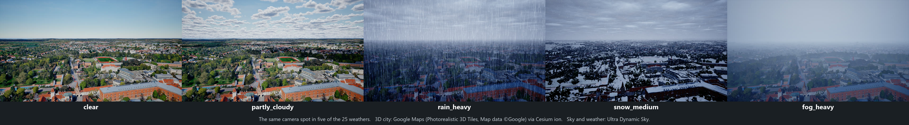
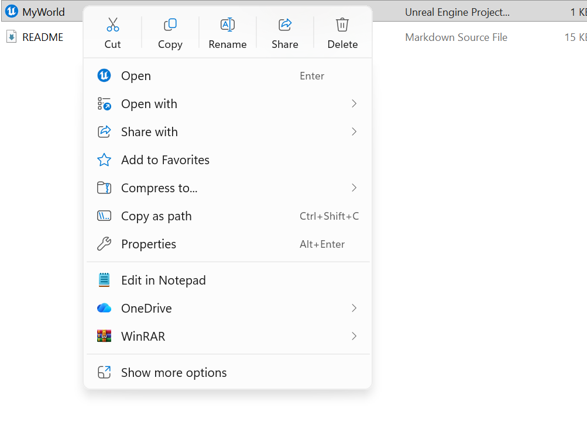
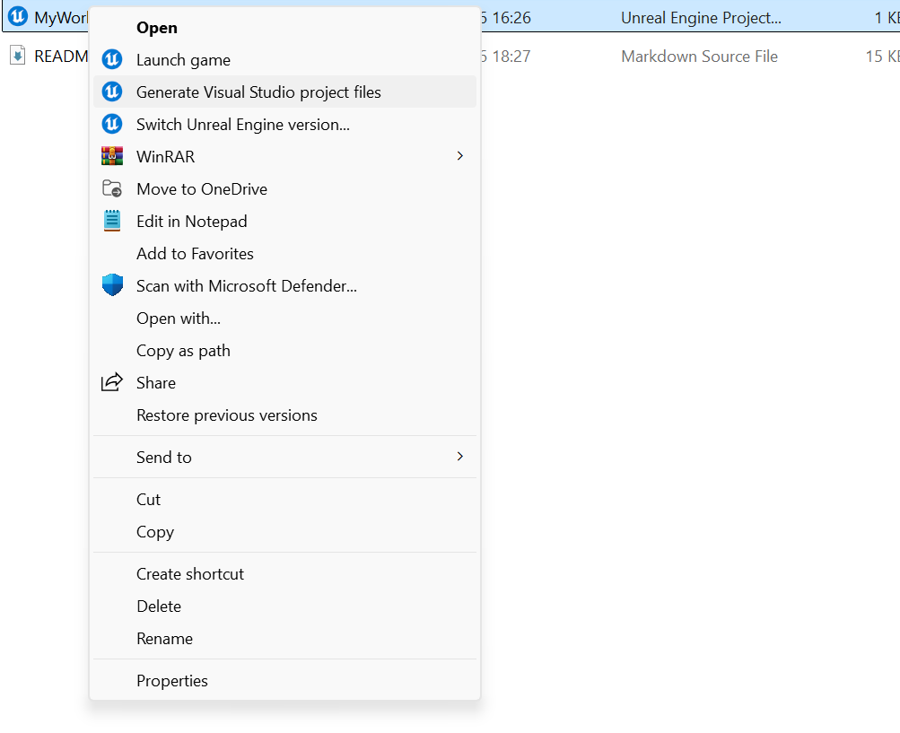

# UE Synthetic Data Generation: Weather Pipeline

Labelled images of real cities in any weather, made in Unreal Engine 5.5. You list the places; the
pipeline flies a camera to random spots there and photographs each spot in every weather you pick,
with a JSON record per image.



## What you need

| | |
|---|---|
| Windows 10/11 with a graphics card | |
| [Unreal Engine 5.5](https://www.unrealengine.com/download) | from the Epic Games Launcher |
| Visual Studio 2022 | in the *Visual Studio Installer*: *More → Import configuration* → this folder's `.vsconfig` (it selects what Unreal needs) |
| [Cesium for Unreal](https://www.fab.com/listings/76c295fe-0dc6-4fd6-8319-e9833be427cd) | free |
| [Ultra Dynamic Sky](https://www.fab.com/listings/84fda27a-c79f-49c9-8458-82401fb37cfb) | paid; tested with version 9.x. Not included here: its Fab license does not allow sharing its files |
| A [Cesium ion](https://ion.cesium.com) account | free |

## Setup (once)

**1. Download this project** (*Code → Download ZIP*, then unzip), e.g. to `C:\Projects\MyWorld`.
Not inside OneDrive.

**2. Install Cesium for Unreal into Unreal Engine 5.5.**
Follow step 1 of Cesium's guide: [Cesium for Unreal Quickstart](https://cesium.com/learn/unreal/unreal-quickstart/).

**3. Put Ultra Dynamic Sky into this project's `Content` folder**, before opening the project:
- **From Fab:** Epic Games Launcher → *Unreal Engine* → *Fab Library* → find *Ultra Dynamic Sky* →
  **Add to Project** → choose `MyWorld` (tick *Show all projects* if it is not listed) → **Add to
  Project**, **or**
- **Already in another project:** with Unreal closed, copy that project's whole
  `Content\UltraDynamicSky` folder into this project's `Content` folder.

It must end up exactly like this (not renamed, not inside another folder):
```
MyWorld\
├─ MyWorld.uproject
└─ Content\
   └─ UltraDynamicSky\
      ├─ Blueprints\
      │  ├─ Ultra_Dynamic_Sky.uasset
      │  └─ Ultra_Dynamic_Weather.uasset
      └─ ... (the rest of the folder)
```
The level already contains the sky and weather actors, so there is nothing to drag into it.

**4. Build.**
1. Right-click `MyWorld.uproject` → **Show more options** → **Generate Visual Studio project files**:

    

2. Double-click `MyWorld.uproject`. Unreal asks *"The following modules are missing or built with a
   different engine version: ... Would you like to rebuild them now?"*. Click **Yes**. The first build
   can take a few minutes; the editor opens when it is done.

   If it says *"could not be compiled. Try rebuilding from source manually."*, open `MyWorld.sln` (created in 1.), choose
   **Development Editor** and **Win64** at the top, and *Build → Build Solution*. Then double-click
   `MyWorld.uproject` again.

**5. Connect your Cesium ion account** in the editor that opens:
1. On [ion.cesium.com](https://ion.cesium.com) → *Asset Depot* → **Google Photorealistic 3D Tiles** →
   *Add to my assets*.
2. In the editor, open the **Cesium** panel (the *Cesium* button in the toolbar) → **Connect to
   Cesium ion** → sign in in the browser window that opens, and allow access.
3. In the Cesium panel click **Token** → **Use an existing token** → pick your *Default Token* →
   **Use as Project Default Token**. (Or **Create a new token** → **Create New Project Default
   Token**.) Step 4 of the [Quickstart](https://cesium.com/learn/unreal/unreal-quickstart/) shows
   these screens.
4. The city appears in the viewport.

**6. Save and close:** in the editor's menu bar **File → Save All** (`Ctrl+Shift+S`), then close the
editor. *Save All* stores your token where the pipeline reads it.

**7. Check it:** in PowerShell, in the project folder (where `MyWorld.uproject` is):
```powershell
.\Tools\weather.cmd --test
```
It should end with `OK` (one test is skipped until you have captured images).

## Capture images

All settings are at the top of **`Tools/weather_pipeline.py`**, each explained there.

```powershell
.\Tools\weather.cmd --imagecount            # check the settings, show image count and time
.\Tools\weather.cmd                         # capture every location
.\Tools\weather.cmd --location Amsterdam    # capture one location
```

Close the Unreal editor first. Keep the `.\` in front: PowerShell needs it. (Inside the `Tools`
folder: `.\weather.cmd`.) A good run looks like this:
```
Images: 4
ETA:    1m 23s
Moving the level to Amsterdam (52.377956, 4.89707) ...
  Level saved.
Capturing 4 images in one session: Amsterdam
  4/4 images  elapsed 48s  ETA 0s
  Finished in 48s

--- Amsterdam: 4/4 images ---
  Checks: all passed.

Done in 57s.
```
Every location must end with `Checks: all passed.`

### Choose your locations

One entry per place in `LOCATION`:

```python
{"name": "Amsterdam", "lat": 52.377956, "lon": 4.897070, "weather": WEATHER_ALL,
 "spots": 20, "area_km2": 1.0, "height_m": [40, 120], "pitch_deg": [-30, -5], "yaw_deg": [0, 360],
 "roll_deg": [0, 0], "time_of_day": [900, 1700], "shot": {"type": "frame"}, "seed": 1,
 "image": {"width": 1920, "height": 1080, "fov_deg": 75.0, "fisheye": False, "auto_exposure": True,
           "exposure_bias": 0, "quality": 3, "tile_error": 12.0},
 "particles": {"rain_drop_scale": 3.0, "snow_flake_scale": 2.0}},
```

| Key | Meaning |
|---|---|
| `name`, `lat`, `lon` | Folder name and centre of the area (south and west negative). |
| `weather` | `WEATHER_ALL`, `WEATHER_BASE`, or your own list of the names below. |
| `spots`, `area_km2` | How many random camera spots, spread over a square this big. |
| `height_m`, `pitch_deg`, `yaw_deg`, `roll_deg`, `time_of_day` | `[low, high]` limits each spot is drawn within. Yaw is the compass heading, 0 = north; time is HHMM. |
| `shot` | `{"type": "frame"}`: one picture per spot. `{"type": "orbit", "radius_m": 100, "pictures": 8}`: 8 pictures round a point 100 m ahead. |
| `seed` | Same number = same spots every run; `None` = new spots each run. |
| `image` | Size, field of view, fisheye, exposure, quality 0–4, `tile_error` (lower = sharper city, more downloads). |
| `particles` | Raindrop and snowflake size (1 = normal). |

Images per location = spots × weathers × pictures per spot.

**Weathers:** `clear`, `partly_cloudy`, `cloudy`, `overcast`, `rain_light`, `rain_medium`,
`rain_heavy`, `rain_fog`, `snow_light`, `snow_medium`, `snow_heavy`, `snow_fog`, `fog_light`,
`fog_medium`, `fog_heavy`, `rain_wind_n|e|s|w`, `snow_wind_n|e|s|w` (wind from that direction),
`partly_cloudy_fog`, `day_after_snow` (snow on the ground, none falling).

## What you get

Each location's folder holds the images (`<weather>_p<NN>.png`; the same `NN` is the same view in
every weather) and `weather_metadata.json`, one record per image:

| | |
|---|---|
| Image | `image_file`, `waypoint_index` (the `NN` in the file name) |
| Camera | `camera_location`, `camera_rotation`, `camera_fov_deg`, `lens`, `image_width`, `image_height` |
| Place | `latitude_deg`, `longitude_deg`, `altitude_m`, `ground_altitude_m`, `height_above_ground_m` |
| Weather | `condition`, `rain`, `snow`, `fog`, `visibility_km`, `cloud_coverage`, `wind_intensity`, `wind_from_deg`, `material_snow_coverage`, `rain_drop_scale`, `snow_flake_scale` |
| Time | `sun_elevation_deg`, `time_of_day` |

Every value is measured in the engine (`null` if it could not be read), and the pipeline checks
every record after the run.

## If something goes wrong

The pipeline stops early and says what to fix. The common messages:

| You see | Do this |
|---|---|
| `The module 'Tools' could not be loaded` | Type `.\` in front: `.\Tools\weather.cmd`. |
| `The Unreal editor is open` | Close the editor. |
| `No Cesium ion access token` / `rejected the access token` | Redo setup steps 5 and 6 (**Save All**). |
| `cannot read Cesium ion asset 2275207` | Add *Google Photorealistic 3D Tiles* to *My Assets* (step 5). |
| `Ultra Dynamic Sky is not in this project` / `must be exactly Content/UltraDynamicSky` | Redo setup step 3. |
| `the level has no Ultra_Dynamic_Sky` | Drag it in from `Content/UltraDynamicSky/Blueprints/`, **Save All**, close. |
| Build: `LiveCoding ... denied` | An Unreal editor is still running (maybe hidden): end `UnrealEditor.exe` in Task Manager. |

<details>
<summary>More: token file, harmless messages, manual mode, other settings, your own shot, tests</summary>

**Token without the editor.** Put your token as one line into `cesium_ion_token.txt` next to
`MyWorld.uproject` (or set `CESIUM_ION_TOKEN`). It is never committed.

**Harmless messages** from Unreal or Cesium, in every project that uses them:
`FCesiumMetadataPropertyStatisticValue::Semantic is not initialized`, `Found a deprecated ini key
name in .../Cesium...`, `Failed to load 'aqProf.dll' / 'VtuneApi.dll' / 'WinPixGpuCapturer.dll'`,
`NiagaraSystem was nullptr for OverrideName "SplatInterface"`, `bCaptureEveryFrame enabled was told
to update` (on purpose, for auto exposure), and `Height calibration: no ground found` at the very
start (measured again once the city has loaded).

**Extra sky actors.** If Ultra Dynamic Sky or Weather was dragged in again, the pipeline keeps one of
each and says `removed the extra ...`. That is fine.

**Manual start.** `AUTOMATE = False`: a window opens over the location; fly (WASD to move, Q and E
for height, the mouse to look) and press **P**. That view is the first spot; the rest are random jumps around it.

**Other settings** in `Tools/weather_pipeline.py`: `OUTPUT_DIR` (where images go), `SUN` (day length
or the real sun on a date, sun size, lens flare), `CLOUDS` (cloud shape), `CLOUD_BASE_ABOVE_GROUND_M`,
`CLEAR_VISIBILITY_KM` (clear-day visibility; every weather's haze scales with it).

**Your own shot** (e.g. a spiral): add a class `USpiralCaptureShot` in
`Plugins/WeatherPipeline/Source/WeatherPipeline/Public/CaptureShots.h` (the file explains how), add
`"spiral"` to `SHOT_TYPES` in `Tools/weather_pipeline.py`, rebuild, and use
`"shot": {"type": "spiral", ...}`.

**Tests.** Python: `.\Tools\weather.cmd --test`. C++ (plugin):
```powershell
& "C:\Program Files\Epic Games\UE_5.5\Engine\Binaries\Win64\UnrealEditor-Cmd.exe" "$PWD\MyWorld.uproject" -ExecCmds="Automation RunTests WeatherPipeline; Quit" -unattended -nullrhi -log
```

**Folders.** `Tools/` the pipeline and its settings · `Plugins/WeatherPipeline/` the capture plugin
(C++) · `Content/` the level, weather presets and geoid data · `Config/` project settings.
</details>

## Credits

This project builds on others' work, which you install yourself:

- **[Cesium for Unreal](https://github.com/CesiumGS/cesium-unreal)** by CesiumGS, Inc. (Apache 2.0),
  and **[Cesium ion](https://cesium.com/platform/cesium-ion/)**, which streams the city tiles.
- **Google Photorealistic 3D Tiles** from Google Maps Platform, through Cesium ion. Google requires
  its attribution wherever the tiles are shown. Check the
  [Map Tiles API policies](https://developers.google.com/maps/documentation/tile/policies) before
  publishing images.
- **[Ultra Dynamic Sky](https://ultradynamicsky.com)** by Everett Gunther: the sky, clouds and weather.
  Buy it on [Fab](https://www.fab.com/listings/84fda27a-c79f-49c9-8458-82401fb37cfb); it is not part of
  this repository.
- **EGM96 geoid model** (`Content/Geoid/WW15MGH.GRD`) from the U.S. National Geospatial-Intelligence
  Agency (NGA), for heights above sea level.
- **[Unreal Engine](https://www.unrealengine.com)** by Epic Games.
